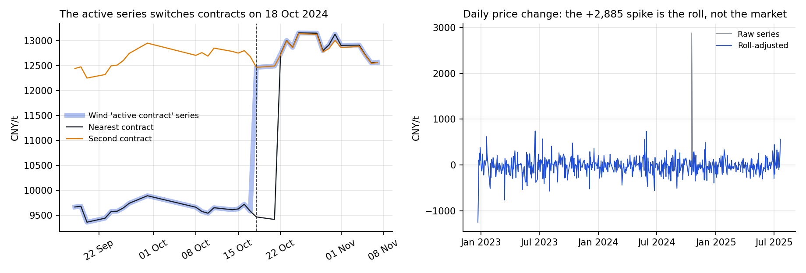
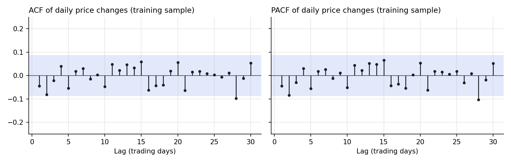
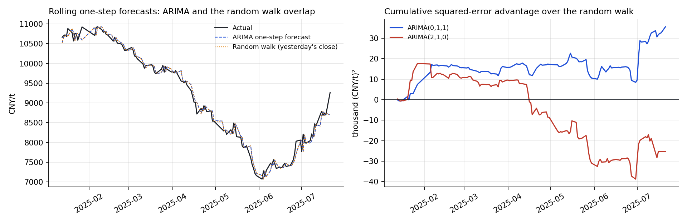
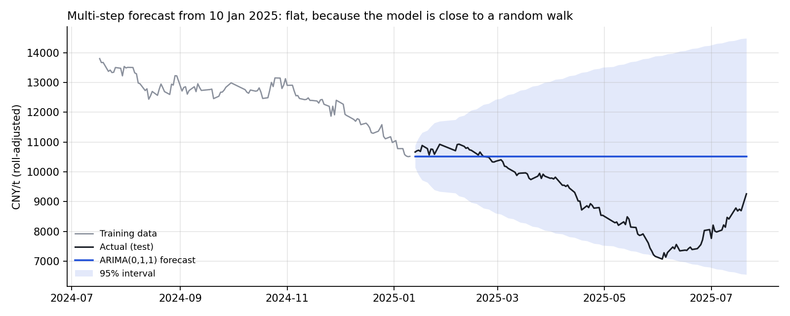
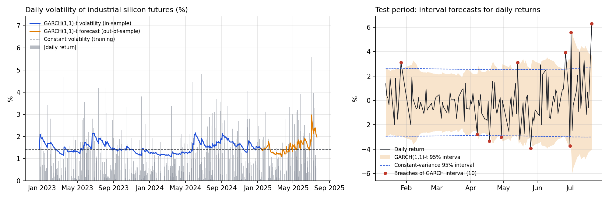
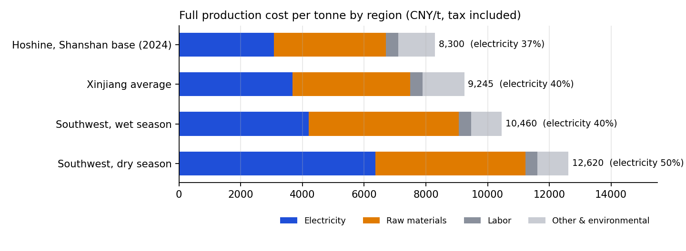
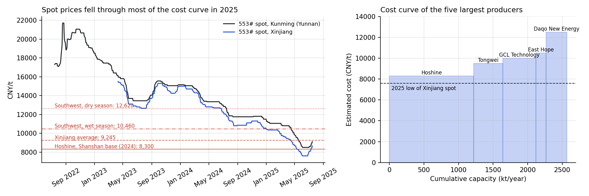
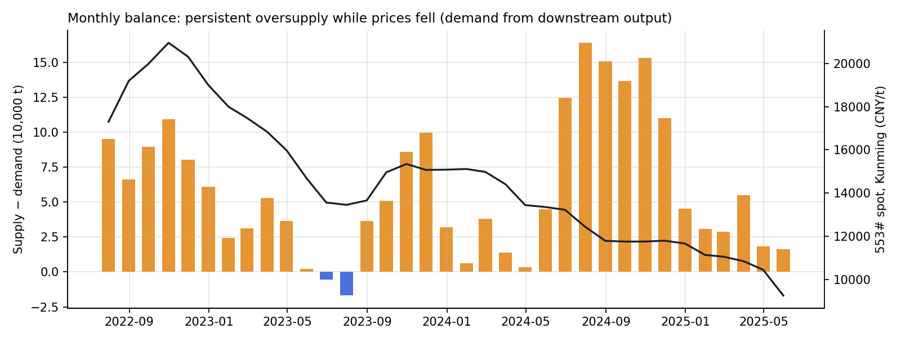
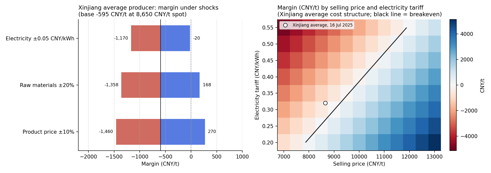
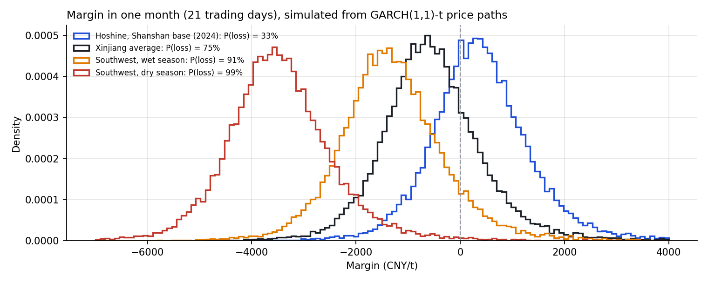

[README.md](https://github.com/user-attachments/files/33697563/README.md)
# Industrial Silicon Futures: Forecasting Prices, Volatility and Fundamentals

**Fundamentals and price forecasting for China's industrial silicon market**

Maggie Deng · Research begun during a summer 2025 internship in the commodities sector; rebuilt and extended October 2026
📄 [Full report (October 2026)](docs/Industrial_Silicon_Report_2026.pdf) · [Original report (July 2025)](docs/Industrial_Silicon_Fundamental_Analysis_2025.pdf)

## Summary

Industrial silicon (metallurgical-grade silicon) is the feedstock for solar polysilicon, silicones and aluminum alloys. China produces over 80% of the world's supply, and futures have traded on the Guangzhou Futures Exchange since December 2022.

This project asks whether classical time-series models can forecast the daily futures price, and what fundamentals say about where prices should be. My original report fitted an ARIMA(0,1,1) model and concluded that rolling one-day-ahead forecasts track prices well. Rebuilding the analysis with a stricter evaluation changes that conclusion:

1. **The price series contained a data artifact.** On 18 October 2024, the vendor's "active contract" series switched to a contract priced 3,100 CNY/t higher and recorded a +30% one-day move. The actual market move that day was −1.7%. That single point drove the extreme kurtosis in the data and hid the volatility clustering.
2. **ARIMA does not beat a random walk.** Forecasting "tomorrow = today" is almost exactly as accurate: RMSE 143.9 vs 144.9, a difference that is not statistically significant (Diebold–Mariano p = 0.10). Direction accuracy is 52%. The good tracking in the report came from the random walk, not from the model.
3. **Volatility is forecastable, even though prices are not.** Once the artifact is removed, volatility clusters (ARCH p = 0.004). A GARCH(1,1) model with fat-tailed Student-t errors fits best and gives the most reliable risk intervals out of sample, reversing the report's conclusion that GARCH-type models are unnecessary.
4. **Fundamentals explain the price level better than the model does.** By June 2025, spot prices had fallen below the estimated cost of even the lowest-cost producer, just before the policy-driven rally in July.

## Research questions

| # | Question | Answer so far |
|---|---|---|
| 1 | Is the vendor's continuous price series fit for modelling? | Not as delivered: one contract roll creates a false 30% move; it needs back-adjustment |
| 2 | Does ARIMA forecast daily prices better than a random walk? | No; differences are within noise for every specification tested |
| 3 | Is volatility clustered, and can it be forecast? | Yes. GARCH(1,1) with Student-t errors fits best and gives the only 95% intervals not rejected by backtests |
| 4 | Do open interest and volume predict price changes? | No; out-of-sample R² is −0.6% relative to the random walk |
| 5 | Where do prices sit relative to production costs? | Below most of the cost curve through mid-2025 |
| 6 | How exposed are producer margins to electricity, raw-material and product prices? | Any single adverse shock turns even the lowest-cost producer loss-making at July 2025 prices |
| 7 | Does the supply-demand balance explain price moves? | Open: estimated oversupply is persistent, but the balance does not reconcile with inventory data |

## Findings

### 1. A contract roll disguised as a 30% price jump

<p align="center"></p>

Wind's "active contract" series follows the most-traded contract and switches as trading moves between delivery months. Most switches cross small spreads of 0–3%. On 18 October 2024, it crossed an unusually large one. The nearest contract fell from 9,580 to 9,465 that day, and the next contract fell from 12,680 to 12,465. The series jumped from 9,580 to 12,465, recording +30.1%.

I detect such days by comparing the series with individual contracts, then back-adjust earlier prices by the spread between contracts, using a difference adjustment for price levels and a ratio adjustment for returns. Its effect on the data:

| Daily log returns | Raw series | Roll-adjusted |
|---|---:|---:|
| Kurtosis (normal = 3) | 75.4 | 5.8 |
| Skewness | 5.04 | 0.17 |
| ARCH-LM p-value (5 lags) | 1.00 | 0.004 |
| Variance of daily price changes, training sample (CNY/t)² | 51,986 | 35,357 |

### 2. ARIMA and the random walk are indistinguishable

The differenced series is stationary (ADF p < 0.001), and the ACF and PACF show no meaningful structure. On a common estimation sample, a plain random walk with drift comes within 0.7 AIC points of the best specification. The estimated MA(1) coefficient is −0.037 (standard error 0.048, p = 0.44).

<p align="center"></p>

The decisive test is out of sample. Each model is re-estimated every day on all data up to the previous close, then forecasts the next close. Test period: 13 January – 21 July 2025, 125 trading days.

| Model | RMSE | MAE | vs random walk | Diebold–Mariano p | Direction accuracy |
|---|---:|---:|---:|---:|---:|
| Random walk (tomorrow = today) | 144.9 | 108.4 | — | — | — |
| ARIMA(0,1,1) | 143.9 | 108.3 | −0.7% | 0.10 | 52% |
| ARIMA(2,1,0), near-best AIC | 145.6 | 109.4 | +0.5% | 0.35 | 48% |
| ARMA(1,0) on log returns | — | — | OOS R² +1.7% | 0.18 | 53% |
| Lagged open interest & volume | — | — | OOS R² −0.6% | — | — |

<p align="center"></p>

The right panel shows where ARIMA(0,1,1)'s small edge comes from: a few individual days in February and July, not a steady advantage. That is what luck looks like.

The static multi-step forecast reproduces the original report: RMSE 1,867, MAE 1,498, sMAPE 16.0%. Its forecast is flat because the model is essentially a random walk. All test prices fall inside the 95% interval, but with intervals this wide that is not strong evidence of calibration.

The rolling one-step intervals cover 98.4% of outcomes against a nominal 95%, so they are too wide. This is a units problem rather than a modelling success. ARIMA on price levels measures volatility in CNY/t. Prices roughly halved between the training and test periods, so CNY-sized moves shrank, even though percentage volatility actually *rose* from 1.42% to 1.68% a day. Modelling log returns, as in the next section, avoids this.

<p align="center"></p>

### 3. Volatility is forecastable: GARCH with fat tails

Prices behave like a random walk, but the *size* of price moves does not: calm and turbulent periods persist. I model daily log returns of the roll-adjusted series (ratio adjustment, which preserves percentage returns) with four variance specifications:
- **Constant variance:** the assumption behind plain ARIMA intervals.
- **EWMA:** RiskMetrics, an exponentially weighted average of past squared returns.
- **GARCH(1,1):** variance mean-reverts after shocks.
- **GJR-GARCH(1,1):** falls and rises may move volatility by different amounts.

Each is estimated with normal and with Student-t errors.

**In-sample (training period, 497 daily returns)**

| Model | Log-likelihood | ΔAIC | Key parameters | Std. residuals still clustered? (ARCH-LM p) |
|---|---:|---:|---|---:|
| Constant variance, normal | −877.5 | 72.3 | | 0.008 |
| Constant variance, t | −845.1 | 9.5 | ν = 3.8 | 0.008 |
| EWMA (λ = 0.94) | −883.7 | 82.6 | | 0.95 |
| GARCH(1,1), normal | −871.3 | 63.8 | α = 0.03, β = 0.93 | 0.41 |
| **GARCH(1,1), t** | **−838.4** | **0** | **α = 0.05, β = 0.93, ν = 3.5** | **0.72** |
| GJR-GARCH(1,1), t | −838.2 | 1.6 | γ = −0.08, ν = 3.6 | 0.71 |

- **Fat tails matter most.** Switching from normal to Student-t errors improves AIC by about 60 points. The estimated ν ≈ 3.5 means extreme days are far more common than a normal distribution allows.
- **Clustering matters next.** GARCH-t beats constant-variance-t by 9.5 AIC points and removes the remaining clustering from the residuals. Persistence α + β = 0.98, so a volatility shock takes about **35 trading days to halve**.
- **No reliable asymmetry.** GJR estimates a negative γ, meaning price *rises* would raise volatility more than falls. That pattern is plausible for a supply-driven commodity prone to short squeezes, but the extra parameter adds almost nothing to the likelihood, and AIC prefers the symmetric model.

**Out of sample (13 Jan – 21 Jul 2025, re-estimated daily)**

Models are scored on one-day-ahead variance forecasts with the QLIKE loss, a standard loss for volatility forecasts that is robust to noise in daily squared returns. They are also scored on how often returns fall outside the 95% interval: about 6 of 125 days should, by construction.

| Model | QLIKE (lower is better) | DM p vs constant | Breaches (expected 6.3) | Kupiec p | Interval width |
|---|---:|---:|---:|---:|---:|
| Constant variance | 2.089 | — | 13 | 0.015 ✗ | 5.5% |
| EWMA | 1.926 | 0.17 | 11 | 0.08 | 5.5% |
| GARCH(1,1), normal | 1.943 | 0.06 | 13 | 0.015 ✗ | 5.6% |
| **GARCH(1,1), t** | **1.920** | **0.08** | **10** | **0.16 ✓** | **6.0%** |
| GJR-GARCH(1,1), t | 1.958 | 0.11 | 11 | 0.08 | 6.0% |

<p align="center"></p>

- **GARCH-t gives the best variance forecasts and the only well-calibrated intervals.** Constant variance and normal GARCH breach their 95% intervals 13 times, twice the expected rate, and the Kupiec test rejects both.
- **The evidence is modest.** QLIKE gains are 6–8% relative to constant variance, with Diebold–Mariano p-values of 0.06–0.17 on a 125-day test window.
- **Policy jumps defeat every model.** Four of GARCH-t's ten breaches fall between 27 June and 21 July 2025, around the anti-involution rally, including the two largest moves of the test period (+5.6% and +6.3% in a day). GARCH raises its forecast only *after* large moves (to about 3% a day by July), so it cannot anticipate policy announcements. That is where a policy-event or sentiment variable would add most value.

### 4. Fundamentals: prices fell through the cost curve

Production cost is built bottom-up as unit consumption × unit price for silica, carbon reductants, electrodes and electricity, plus labor and overheads. Inputs come from plant feasibility studies, environmental impact assessments and market data.

<p align="center"></p>

Electricity is the swing factor. Its share of total cost ranges from 37% for Hoshine, which runs its own power plants, to 50% in the Southwest dry season, when hydropower is scarce. At fixed usage, the elasticity of total cost to the electricity price equals electricity's cost share, about 0.37 at the Hoshine baseline.

<p align="center"></p>

Xinjiang 553# spot fell to **7,600 CNY/t on 4 June 2025**, below the estimated 8,300 of the lowest-cost producer and well below the 9,245 Xinjiang average. With nearly the whole industry under water, the July 2025 rally followed government statements against "involution" (destructive price competition) rather than any change in measured supply or demand. That is a reminder that this market trades on policy expectations as much as on fundamentals.

<p align="center"></p>

The monthly balance follows the report's method:
- **Supply** = metallurgical silicon + 97# silicon + recycled silicon + imports.
- **Demand** = 1.08 × polysilicon + 0.52 × DMC + 0.22 × primary aluminum alloy + exports, where each factor is the industrial silicon used per tonne of downstream output.

Supply exceeds estimated demand in 33 of 35 months, consistent with the falling price. However, the implied surplus averages about 59,000 t a month, while reported social inventory rose by only about 12,600 t a month (99,000 t to 551,000 t over three years). Either some demand is unmeasured, or much of the stock sits at plants rather than in social warehouses.

Solar demand barely reacts to the silicon price. A wafer needs 1.6–2.0 g of polysilicon per watt, so a +1,000 CNY/t rise in silicon adds only about 0.002 CNY per watt to module cost.

| Cell type | Wafer thickness (mm) | Efficiency | Polysilicon (g/W) | Added cost per W for +1,000 CNY/t (CNY) |
|---|---:|---:|---:|---:|
| M10-182 PERC | 0.150 | 23.5% | 2.01 | 0.0021 |
| G12-210 PERC | 0.150 | 23.4% | 2.02 | 0.0021 |
| 183R | 0.125 | 25.5% | 1.62 | 0.0017 |
| G12-210 TOPCon | 0.125 | 25.6% | 1.62 | 0.0017 |
| HJT | 0.120 | 25.5% | 1.58 | 0.0016 |
| 210R | 0.125 | 25.9% | 1.60 | 0.0017 |

### 5. Margins and stress tests

Margin = selling price − full production cost, with Xinjiang producers valued at Xinjiang 553# spot and Southwest producers at Kunming 553# spot.

| Producer | Full cost | 2024 average | 2025 low (4 Jun) | Latest (16 Jul 2025) |
|---|---:|---:|---:|---:|
| Hoshine, Shanshan | 8,300 | +4,048 (33%) | −700 | +350 (4%) |
| Xinjiang average | 9,245 | +3,103 (25%) | −1,645 | −595 |
| Southwest, wet season | 10,460 | +2,476 (19%) | −1,960 | −1,360 |
| Southwest, dry season | 12,620 | +316 (2%) | −4,120 | −3,520 |

<p align="center"></p>

The three shocks are of similar size:
- a 10% move in the product price shifts margins by 865–910 CNY/t;
- a 0.05 CNY/kWh move in the electricity tariff shifts them by 550–600 CNY/t;
- a 20% move in raw-material prices shifts them by 725–970 CNY/t.

At July 2025 prices, any one adverse shock makes even Hoshine loss-making.

Simulating one month of prices from the fitted GARCH(1,1)-t model gives each producer's probability of a loss a month ahead:
- **Hoshine:** 33%
- **Xinjiang average:** 75%
- **Southwest, wet season:** 91%
- **Southwest, dry season:** 99%

The simulated monthly 90% price range is ±18%, against ±11% under constant volatility.

<p align="center"></p>

## All models at a glance

| Question | Model | Outcome | Interpretation |
|---|---|---|---|
| Where will the price be tomorrow? | Random walk | RMSE 144.9 CNY/t (1.2% of price) | The benchmark to beat |
| | ARIMA(0,1,1) | −0.7% RMSE vs random walk, p = 0.10 | MA term ≈ −0.04: almost no memory in daily price changes |
| | ARIMA(2,1,0) | +0.5% RMSE vs random walk | Best in-sample fit forecasts worse: overfitting noise |
| | Lagged open interest and volume | Out-of-sample R² −0.6% | Positioning data carry no next-day signal |
| Where will it be in six months? | ARIMA static forecast | Flat line; RMSE 1,867 | A random walk's best guess is today's price; it cannot anticipate trends |
| How much will it move tomorrow? | Constant variance | Breaches 95% interval twice as often as it should | Risk understated in turbulent periods |
| | EWMA | Fewer breaches (11); backtest borderline (p = 0.08) | Adapts to recent turbulence, but never reverts to a long-run level |
| | **GARCH(1,1), t** | **Best QLIKE; interval breaches consistent with 95%** | **Volatility clusters (half-life ≈ 35 days) and tails are fat (ν ≈ 3.5)** |
| | GJR-GARCH(1,1), t | No gain over GARCH | No robust evidence that rises and falls affect volatility differently |
| Where should the price be? | Bottom-up cost model | Spot fell below the lowest-cost producer's cost in June 2025 | Price was unsustainably low before the policy rally |

The overall lesson is consistent with an efficient but policy-sensitive market. The *direction* of daily price moves is unpredictable from past prices or positioning, but their *magnitude* is predictable. Fundamentals indicate when prices are far from sustainable levels without saying when they will revert, and policy news moves prices in ways no time-series model anticipates.

## What changed from the original report

| Original report (July 2025) | This version |
|---|---|
| Futures are listed on the Shanghai Futures Exchange | Corrected: Guangzhou Futures Exchange (GFEX), listed 22 Dec 2022 |
| Modelled the vendor series as delivered | Detects and back-adjusts the 18 Oct 2024 contract roll |
| ARCH-LM p = 1.00, so GARCH not needed | With the artifact removed, ARCH effects are significant (p = 0.004); GARCH(1,1)-t is the best volatility model in and out of sample |
| MA(1) = −0.081, p = 0.014 | MA(1) = −0.04, not significant (p ≈ 0.4) on both raw and adjusted data. The likelihood is flat, and the original p-value used outer-product standard errors, which are unreliable with heavy tails |
| Order chosen by stepwise auto-ARIMA | Exhaustive search on a common sample; all candidates fall within 2 AIC points |
| Rolling one-step forecasts "track prices with strong accuracy" | Compared with a random walk, the tracking comes from the random walk; no significant gain |
| The 95% interval contains all test prices, so the model is well calibrated | Price-level intervals are too wide because volatility is measured in CNY while prices halved; return-based GARCH-t intervals are the calibrated ones |
| Primary aluminium alloy output "highly stable" (YoY 0.20%, 0.28%, ...) | The YoY figures were fractions: growth was +20% and +28% in Jan–Feb 2025, slowing to about zero by June |
| Static forecast: RMSE 1,866.61, MAE 1,497.75, sMAPE 16.03% | Reproduced: RMSE 1,866.84, MAE 1,497.94, sMAPE 16.03% |

## Open questions

- **Volatility around policy events.** Do jump components, or dummies for scheduled policy meetings, fix the interval breaches GARCH-t still shows in July 2025? Would intraday data (realized volatility) sharpen the forecasts?
- **Policy and sentiment.** Can a policy-sentiment index explain moves like July 2025? For example, text-mining official statements and running event studies around government meetings.
- **The balance-sheet puzzle.** Can the demand estimate be reconciled with inventory data, and does the surplus or the price's distance from the cost curve predict monthly returns? With 35 months of data, this needs care to avoid overfitting.
- **Term structure.** The 3,100 CNY/t spread between adjacent contracts in October 2024 is itself informative. What does the futures curve imply about expected supply?
- **Nonlinear models.** Random forests, gradient boosting or LSTMs on fundamentals and positioning data, held to the same random-walk benchmark.

## Repository structure

```
├── src/sifutures/
│   ├── data.py            # loaders, Chinese → English headers, roll detection and adjustment, monthly balance
│   ├── timeseries.py      # ADF, ACF/PACF, Ljung–Box, ARCH-LM, Jarque–Bera (numpy/scipy)
│   ├── arima.py           # ARIMA(p,1,q) with drift: estimation, forecasts, intervals, order search
│   ├── evaluate.py        # metrics, rolling one-step forecasts, Diebold–Mariano, predictive regressions
│   ├── volatility.py      # constant, EWMA, GARCH and GJR-GARCH (normal / Student-t), backtests
│   └── fundamentals.py    # cost model, electricity sensitivity, cost curves, silicon intensity of PV
├── scripts/
│   ├── 01_data_audit.py   # find and adjust contract rolls
│   ├── 02_forecast.py     # diagnostics, ARIMA, evaluation against the random walk
│   ├── 04_volatility.py   # volatility models in and out of sample
│   ├── 05_margin_stress.py # producer margins, stress tests, GARCH-simulated margin risk
│   └── 03_fundamentals.py # costs, spot vs cost curve, supply-demand balance
├── results/               # metrics and tables written by the scripts
├── figures/
├── tests/                 # unit tests on simulated data, plus a cross-check against statsmodels
├── data/README.md         # data sources and the Chinese → English data dictionary
├── legacy/                # original research scripts
└── docs/                  # full report (2026) and original report (2025)
```

The time-series tools are implemented directly with numpy and scipy, so every step is transparent. `tests/test_against_statsmodels.py` checks them against statsmodels and the `arch` package.

## Running it

The raw data are licensed vendor data (Wind, SMM) and are not included; see [`data/README.md`](data/README.md) for the expected files.

```bash
pip install -r requirements.txt
python scripts/01_data_audit.py
python scripts/02_forecast.py
python scripts/03_fundamentals.py
python scripts/04_volatility.py
python scripts/05_margin_stress.py
python -m pytest tests
```

## Contact

Maggie Deng · [LinkedIn](http://www.linkedin.com/in/maggie-deng-52314a2b3) · [GitHub](https://github.com/dengyuhe)
